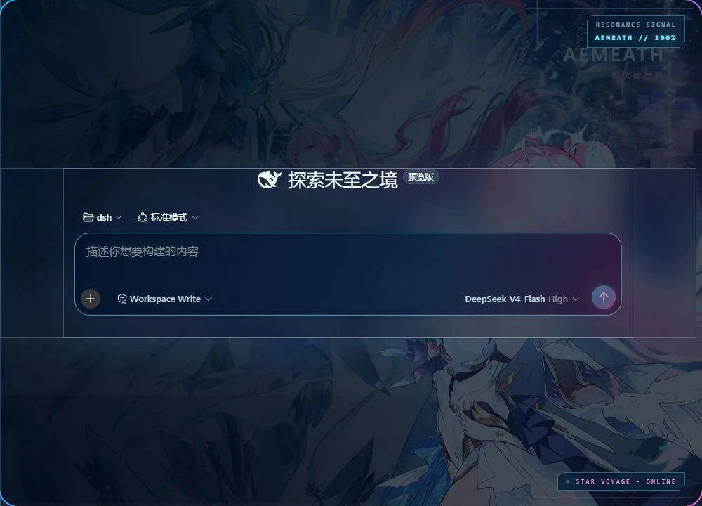
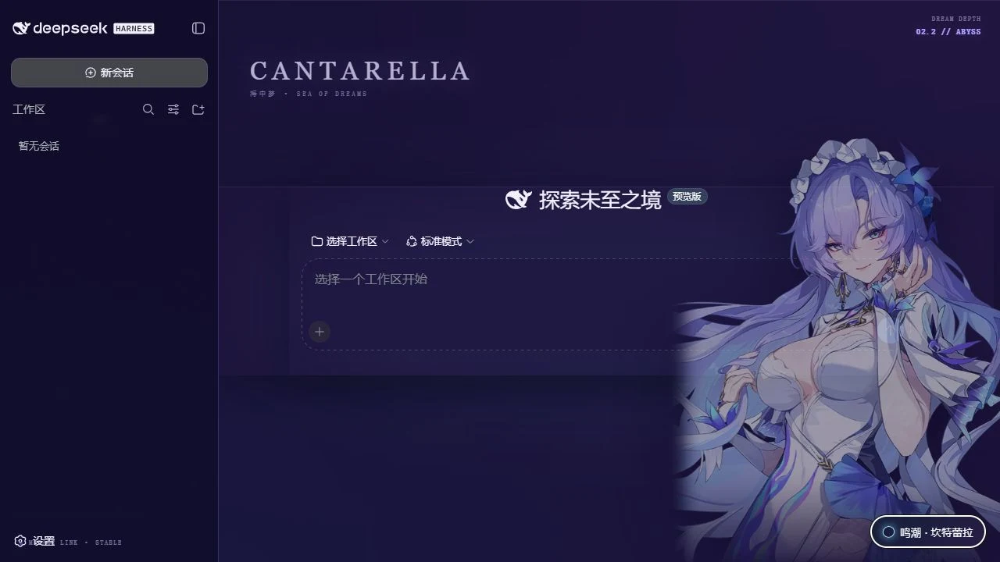
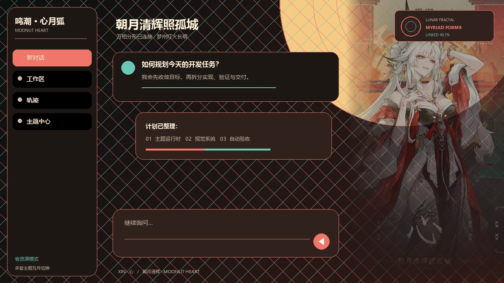
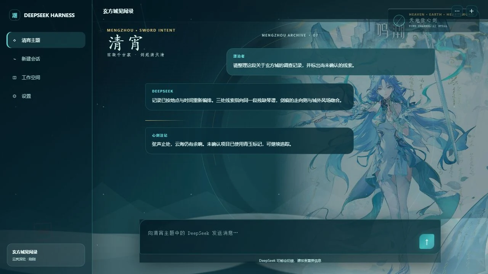
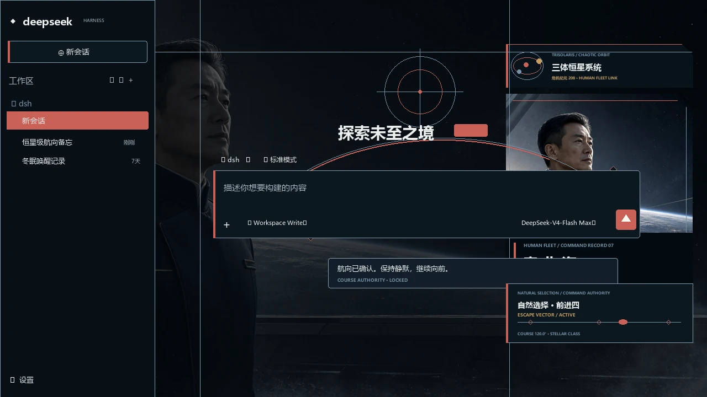
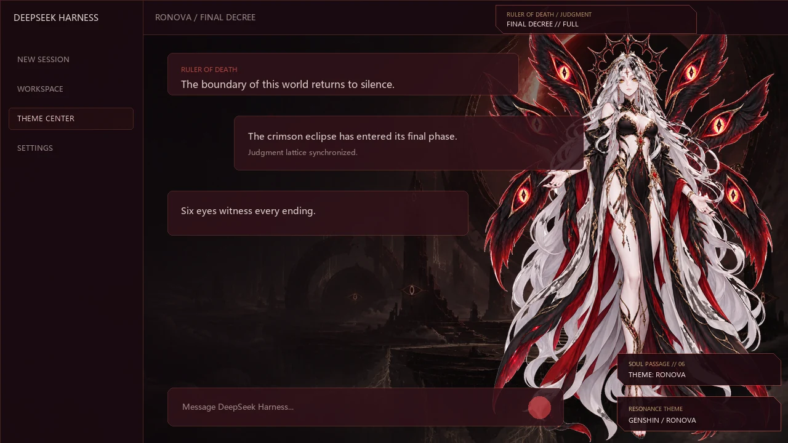

# dsh-WutheringWaves

面向 [DeepSeek Harness](https://github.com/deepseek-ai) Web GUI 的可切换角色主题集合。最初以《鸣潮》起步，现已覆盖鸣潮、三体与原神角色主题。

<p>
  
  
  
  
  
</p>

每个主题都是独立的 DSH 客户端皮肤插件：可同时安装，由「主题中心」互斥切换，随时恢复官方外观。主题中心默认在页面右下角，可以拖到其他位置。角色主题与 DSH 自带的浅色 / 深色设置相互独立。

> 非官方、非商业的同人主题，与库洛游戏、米哈游 / HoYoverse、《三体》权利方及 DeepSeek 均无隶属或合作关系。原创代码使用 MIT 许可；角色与美术素材不在 MIT 范围内，详见 [许可与素材](#许可与素材)。

## 预览

深色模式：

<p align="center">
  
  
</p>
<p align="center">
  
  
</p>
<p align="center">
  
  
</p>

浅色模式预览见各主题目录下的 `preview/light.webp`。

## 功能

- **可装可不启用**：安装后默认仍是官方外观，由主题中心按需挂载。
- **多主题共存、互斥生效**：任意时刻只渲染一套皮肤；切换失败会回滚到上一套。
- **按站点记住选择**：主题与性能档保存在当前 DSH 站点（`localStorage`，必要时回退 Cookie）。
- **省资源优先**：默认关闭持续动画、实时毛玻璃和非必要装饰，适合云电脑；可随时切到完整动态。
- **本地素材**：运行时只从插件自己的本地路由加载 WebP，不访问官方 CDN，也不把图片打进 Base64。
- **可完整卸载**：切回官方外观或移除插件后，主题节点、样式、标题和 `theme-color` 都会被清理。

## 主题一览

| 主题 | 版本 | 视觉意象 | 包名 |
| --- | --- | --- | --- |
| [鸣潮 · 爱弥斯](themes/aemeath) | 0.3.2 | 星海蓝、樱粉与暖金长航 | `@dsh-external/dsh-client-ui-skin-wuthering-aemeath` |
| [鸣潮 · 坎特蕾拉](themes/cantarella) | 0.3.2 | 深海幻梦、水母与紫蓝潮汐 | `@dsh-external/dsh-client-ui-skin-wuthering-cantarella` |
| [鸣潮 · 心月狐](themes/xinyuehu) | 0.3.1 | 玄方月苑、月门屏风与机关分形 | `@dsh-external/dsh-client-ui-skin-wuthering-xinyuehu` |
| [鸣潮 · 清宵](themes/qingxiao) | 0.1.1 | 梦州云海、琴弦心剑与青玉冷光 | `@dsh-external/dsh-client-ui-skin-wuthering-qingxiao` |
| [三体 · 章北海](themes/zhangbeihai) | 0.3.4 | 舰桥晨光、三恒星轨道与舰队航向 | `@dsh-external/dsh-client-ui-skin-threebody-zhangbeihai` |
| [原神 · 若娜瓦](themes/ronova) | 0.2.3 | 赤月终焉、六翼神瞳与死生律令 | `@dsh-external/dsh-client-ui-skin-genshin-ronova` |

## 安装

需要已安装 DeepSeek Harness CLI，并使用 `web` profile。当前已在 `@deepseek-ai/dsh@0.2.2-rc.1` 上验证。主题包不发布到 npm；可安装产物在 [GitHub Releases](https://github.com/frank6892103/dsh-WutheringWaves/releases)，按集合版本号（如 `v0.6.0`）浏览。

`dsh plugin` 会把参数交给 pnpm。同一 `.tgz` 也可用 `pnpm add` 或 `npm install` 从远端 URL 或本地文件安装；若目标是 DSH GUI，请使用 `dsh plugin`。

### 从 GitHub Release 安装

钉死当前集合版本：

```powershell
dsh plugin --profile web add https://github.com/frank6892103/dsh-WutheringWaves/releases/download/v0.6.0/dsh-external-dsh-client-ui-skin-wuthering-aemeath-0.3.2.tgz
dsh plugin --profile web add https://github.com/frank6892103/dsh-WutheringWaves/releases/download/v0.6.0/dsh-external-dsh-client-ui-skin-wuthering-cantarella-0.3.2.tgz
dsh plugin --profile web add https://github.com/frank6892103/dsh-WutheringWaves/releases/download/v0.6.0/dsh-external-dsh-client-ui-skin-wuthering-xinyuehu-0.3.1.tgz
dsh plugin --profile web add https://github.com/frank6892103/dsh-WutheringWaves/releases/download/v0.6.0/dsh-external-dsh-client-ui-skin-wuthering-qingxiao-0.1.1.tgz
dsh plugin --profile web add https://github.com/frank6892103/dsh-WutheringWaves/releases/download/v0.6.0/dsh-external-dsh-client-ui-skin-threebody-zhangbeihai-0.3.4.tgz
dsh plugin --profile web add https://github.com/frank6892103/dsh-WutheringWaves/releases/download/v0.6.0/dsh-external-dsh-client-ui-skin-genshin-ronova-0.2.3.tgz
dsh --profile web --dump-config
dsh web
```

跟随最新 Release（文件名不含主题版本号）：

```powershell
dsh plugin --profile web add https://github.com/frank6892103/dsh-WutheringWaves/releases/latest/download/dsh-external-dsh-client-ui-skin-wuthering-aemeath.tgz
```

包管理器等价命令（同一 URL）：

```powershell
pnpm add https://github.com/frank6892103/dsh-WutheringWaves/releases/download/v0.6.0/dsh-external-dsh-client-ui-skin-wuthering-aemeath-0.3.2.tgz
npm install https://github.com/frank6892103/dsh-WutheringWaves/releases/download/v0.6.0/dsh-external-dsh-client-ui-skin-wuthering-aemeath-0.3.2.tgz
```

### 从本地文件安装

从 [Releases](https://github.com/frank6892103/dsh-WutheringWaves/releases) 下载 `.tgz`，或在克隆的仓库根目录执行 `pnpm run themes:release` 后，在该目录执行：

```powershell
dsh plugin --profile web add ./dsh-external-dsh-client-ui-skin-wuthering-aemeath-0.3.2.tgz
dsh plugin --profile web add ./dsh-external-dsh-client-ui-skin-wuthering-cantarella-0.3.2.tgz
dsh plugin --profile web add ./dsh-external-dsh-client-ui-skin-wuthering-xinyuehu-0.3.1.tgz
dsh plugin --profile web add ./dsh-external-dsh-client-ui-skin-wuthering-qingxiao-0.1.1.tgz
dsh plugin --profile web add ./dsh-external-dsh-client-ui-skin-threebody-zhangbeihai-0.3.4.tgz
dsh plugin --profile web add ./dsh-external-dsh-client-ui-skin-genshin-ronova-0.2.3.tgz
dsh --profile web --dump-config
dsh web
```

```powershell
pnpm add ./dsh-external-dsh-client-ui-skin-wuthering-aemeath-0.3.2.tgz
npm install ./dsh-external-dsh-client-ui-skin-wuthering-aemeath-0.3.2.tgz
```

不必一次装完；只装需要的主题即可。组合配置中应出现对应的 `ui-skin-*` 行。若 Web 服务已在运行，请先停止再启动。

校验文件哈希：

```powershell
Get-Content .\THEME-SHA256SUMS.txt
Get-FileHash -Algorithm SHA256 .\*.tgz
```

更完整的接收方说明见 [`release/INSTALL-THEMES.md`](release/INSTALL-THEMES.md)。

## 使用

1. 打开 DSH Web 页面，点击 **主题中心**。它默认在右下角；按住按钮或面板标题可以拖到别的位置，刷新后仍留在那里。心月狐、章北海、若娜瓦贴在选择框上的铭牌会一起移动，打开列表时先让开。爱弥斯右上角的「RESONANCE SIGNAL」避开 DSH 功能按钮。
2. 选择已安装的角色主题，或 **官方外观**。
3. 需要完整动效时，将「动态效果」从默认的 **省资源** 改为 **完整**。

系统开启「减少动态效果」时，即使选择完整档也不会播放主题动画。主题选择按浏览器同源保存，不跨主机名、端口或浏览器同步。

程序化接口（可选）：

```js
window.__DSH_WUTHERING_THEME_HUB__.list()
window.__DSH_WUTHERING_THEME_HUB__.setActive('wuthering-aemeath')
window.__DSH_WUTHERING_THEME_HUB__.setActive('official')
window.__DSH_WUTHERING_THEME_HUB__.setPerformance('economy') // 或 'full'
window.__DSH_WUTHERING_THEME_HUB__.getPosition() // 未拖动过为 null
```

## 卸载

在主题中心选择「官方外观」即可立即恢复。若要移除插件：

```powershell
dsh plugin --profile web remove @dsh-external/dsh-client-ui-skin-wuthering-aemeath
dsh plugin --profile web remove @dsh-external/dsh-client-ui-skin-wuthering-cantarella
dsh plugin --profile web remove @dsh-external/dsh-client-ui-skin-wuthering-xinyuehu
dsh plugin --profile web remove @dsh-external/dsh-client-ui-skin-wuthering-qingxiao
dsh plugin --profile web remove @dsh-external/dsh-client-ui-skin-threebody-zhangbeihai
dsh plugin --profile web remove @dsh-external/dsh-client-ui-skin-genshin-ronova
```

卸载当前活动主题时会自动退回官方外观。

## 开发

```powershell
pnpm install
pnpm run themes:build
pnpm run themes:test
pnpm run themes:release
pnpm run github:release
pnpm run web
```

| 命令 | 作用 |
| --- | --- |
| `pnpm run themes:build` | 构建全部六个主题的 client bundle |
| `pnpm run themes:test` | 校验注册表、主题中心协议与各主题一致性 |
| `pnpm run themes:release` | 在 `release/` 生成 `.tgz`、校验和与安装说明（不发布 npm） |
| `pnpm run github:release` | 打包后用 GitHub CLI 创建 `v*` Release（需已登录 `gh`；日常发版请推送标签由 Actions 完成） |
| `pnpm run theme:<id>:build` | 构建单个主题，`id` 为 `aemeath` / `cantarella` / `xinyuehu` / `qingxiao` / `zhangbeihai` / `ronova` |
| `pnpm run web` | 启动本地 DSH Web |

每个主题包自带 `scripts/build-client.mjs`、`scripts/verify.mjs` 和 `scripts/release.mjs`。`lib/client.js` 由构建生成，不要手改。

```text
dsh-WutheringWaves/
├── themes/                 # 六个独立 DSH 皮肤包
│   └── <theme>/
│       ├── src/            # 源码（host 入口、client runtime、CSS）
│       ├── lib/            # 预构建产物
│       ├── assets/         # 本地图片与 source.json
│       ├── preview/        # 亮 / 暗真实页面截图
│       ├── skin.json       # 皮肤元数据
│       ├── cordis.patch.yml
│       ├── NOTICE          # 素材权利边界
│       └── LICENSE-CODE    # 代码 MIT 许可
├── shared/theme-hub-runtime.js
├── theme-registry.json     # 可安装主题与切换协议
├── scripts/                # 联合校验与发布
├── release/                # 安装说明与校验清单；`.tgz` 由打包脚本生成，正式包在 GitHub Release
└── docs/                   # 需求规格
```

## 许可与素材

- **原创程序代码**：MIT，见各主题目录的 [`LICENSE-CODE`](themes/aemeath/LICENSE-CODE)。
- **角色、美术、预览截图**：不随 MIT 授权，仅供非商业本地界面使用。来源、获取日期与限制见：
  - [themes/aemeath/NOTICE](themes/aemeath/NOTICE)
  - [themes/cantarella/NOTICE](themes/cantarella/NOTICE)
  - [themes/xinyuehu/NOTICE](themes/xinyuehu/NOTICE)
  - [themes/qingxiao/NOTICE](themes/qingxiao/NOTICE)
  - [themes/zhangbeihai/NOTICE](themes/zhangbeihai/NOTICE)
  - [themes/ronova/NOTICE](themes/ronova/NOTICE)

《鸣潮》及相关角色归库洛游戏；《原神》及相关角色归米哈游 / HoYoverse；《三体》及相关作品元素归其各自权利人。本仓库不授予这些素材的再分发或商业使用许可。

## 设计文档

内部规格按实现顺序归档，新读者可从安装与主题目录 README 入手。

- [spec000 · 爱弥斯主题皮肤插件](docs/spec000-DeepSeek-Harness-Web-GUI鸣潮爱弥斯主题皮肤插件.md)
- [spec001 · 按 DSH 规范打包](docs/spec001-按照DSH插件发布规范打包.md)
- [spec002 · 增强浅色主题辨识度](docs/spec002-研究并增强浅色主题辨识度.md)
- [spec003 · 修复设置面板被侧栏裁剪](docs/spec003-修复设置面板被侧栏裁剪.md)
- [spec004 · 多主题切换](docs/spec004-支持多主题可切换.md)
- [spec005 · 主题性能优化](docs/spec005-主题插件性能极致优化.md)
- [spec006 · 心月狐主题](docs/spec006-鸣潮心月狐主题.md)
- [spec007 · 清宵主题](docs/spec007-鸣潮清宵主题.md)
- [spec008 · 章北海主题](docs/spec008-三体章北海主题.md)
- [spec009 · 若娜瓦主题](docs/spec009-原神若娜瓦主题.md)
- [spec010 · GitHub Release 发布](docs/spec010-GitHub的release发布.md)
